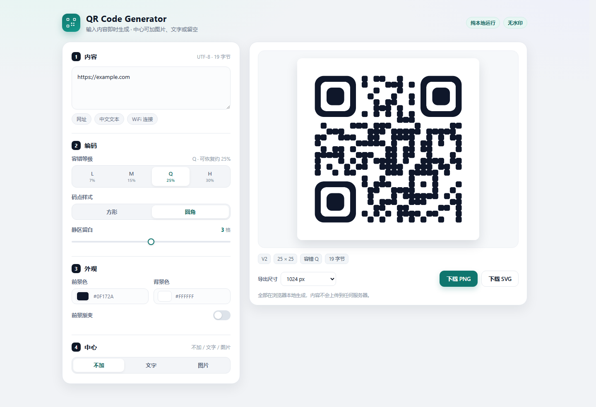
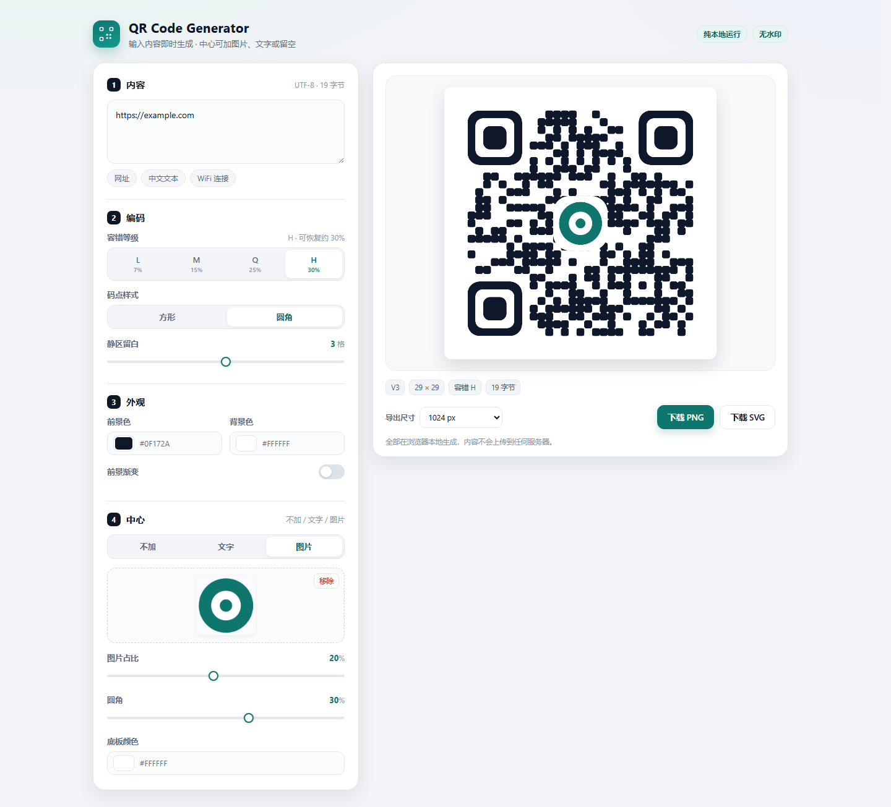

<div align="center">

# QR Code Generator

**纯前端 · 单文件 · 可离线运行的二维码生成器**

输入内容即时生成，支持在二维码中心嵌入 Logo 或文字，一键导出 PNG / SVG。

[](#快速开始)
[](#技术实现)
[](#常见问题)
[](LICENSE)

</div>



## 目录

- [简介](#简介)
- [特性](#特性)
- [快速开始](#快速开始)
- [使用指南](#使用指南)
- [扫码可靠性](#扫码可靠性)
- [项目结构](#项目结构)
- [技术实现](#技术实现)
- [浏览器支持](#浏览器支持)
- [常见问题](#常见问题)
- [许可证](#许可证)

## 简介

一个打开就能用的二维码生成器：全部代码在同一个 `index.html` 里，不需要安装、不需要网络、不上传任何内容。除了常规的文本／网址二维码，它还能把一张 Logo 或几行文字放进码心，并实时给出可扫性提示（容错等级、静区、中心占比）。

适合做活动海报、菜单、名片、包装上的二维码，也适合当作一个「单文件工具」的示例项目。



## 特性

- **单文件交付**：一个 `index.html` 包含页面、样式、逻辑和二维码编码库，复制即用。
- **零依赖、零请求**：不加载任何 CDN、字体或统计脚本，断网也能用。
- **实时预览**：输入、改色、换样式、加图，预览立即更新。
- **三种中心形态**：不加 / 文字 / 图片，随时切换。
  - 文字：最多 3 行、36 字符，可换行，字号、文字色、底板色可调。
  - 图片：点击选择或直接拖入，支持占比与圆角调整，自动缩放到安全尺寸。
- **容错可控**：L / M / Q / H 四档，添加中心元素时自动提升到 H，避免"好看但扫不出"。
- **可定制外观**：方形／圆角码点、前景色与背景色、线性渐变、0–6 格静区留白。
- **双格式导出**：PNG（512 / 1024 / 2048 / 3072 px）与 SVG 矢量。
- **完整 UTF-8**：中文、emoji、长链接都能正确编码。
- **桌面与移动端自适应**：窄屏时预览自动置顶。

## 快速开始

### 方式一：直接打开

下载仓库，双击 `index.html` 即可（推荐 Chrome / Edge）。

### 方式二：克隆仓库

```bash
git clone https://github.com/<your-name>/qr-code-generator.git
cd qr-code-generator
```

### 部署到 GitHub Pages

1. 把 `index.html` 推到仓库默认分支；
2. 在 **Settings → Pages** 中选择 `Deploy from a branch`，分支选 `main`、目录选 `/ (root)`；
3. 稍等片刻即可通过 `https://<your-name>.github.io/qr-code-generator/` 访问。

> 因为不依赖任何外部资源，Pages、本地文件、内网离线环境下的表现完全一致。

## 使用指南

1. **输入内容**：网址、普通文本，或点一下「WiFi 连接」填入标准 WiFi 串。
2. **选择容错**：默认 `Q`（约 25% 可恢复）；要加中心内容就选 `H`（程序会自动切）。
3. **调整外观**：码点样式、配色、渐变、静区。
4. **添加中心元素**：切到「文字」输入内容，或切到「图片」上传 Logo。
5. **导出**：选尺寸后下载 PNG，或下载可无损缩放的 SVG。

### 中心元素建议

| 类型 | 建议范围 | 说明 |
| --- | --- | --- |
| 无 | 任意 | 容错 `Q` 已足够，静区保持 3 格以上 |
| 文字 | 1–2 行，字号 10%–11% | 超过 11% 时提示"识别率下降"；3 行会按高度自动缩字 |
| 图片 | 占比 18%–22%，圆角 30% | 超过 25% 会提示；建议用图形简洁、透明底或白底的 Logo |

### 导出尺寸

| 尺寸 | 适用场景 |
| --- | --- |
| 512 px | 网页、聊天分享 |
| 1024 px | 默认，屏幕展示、常规物料 |
| 2048 px | 海报、易拉宝、高清屏 |
| 3072 px | 印刷（建议同时导出 SVG） |

## 扫码可靠性

开发期用 [jsQR](https://github.com/cozmo/jsQR) 对渲染结果／栅格化后的 SVG 做解码验证（模块约 16 px）：

| 场景 | 容错 | 结果 |
| --- | --- | --- |
| 纯二维码（默认参数） | Q | 通过 |
| 中心 2 字文字（字号 10%） | H | 通过 |
| 中心 3 行文字 | H | 通过 |
| 中心 Logo 20% | H | 通过 |
| 中心 Logo 30% | H | 通过 |
| 约 80 字符长链接 + Logo 20% | H | 通过 |
| 1024 px SVG 栅格化 | Q | 通过 |
| 中心文字 | Q | 未通过（因此添加中心元素时自动切到 H） |

结论：**只要加中心内容就用 H，文字不超过 11%、图片不超过 25%**，并保留至少 3 格静区，实际手机扫描器会比测试条件更宽容。

## 项目结构

```
qr-code-generator/
├── index.html          # 应用本体：样式、逻辑、二维码编码库全部内联
├── README.md
├── LICENSE
└── docs/
    ├── preview.png     # 默认界面
    └── preview-logo.png
```

## 技术实现

- **原生 HTML / CSS / JS**：无框架、无构建步骤、无 npm 依赖。
- **Canvas 2D 自绘码点**：以「整格 × 整数倍」计算像素，避免半像素导致的模糊与缝隙；圆角样式对三个定位眼单独绘制圆角环与中心圆点。
- **SVG 逐模块输出**：1 个模块 = 1 个坐标单位，印刷时无锯齿；方形样式使用 `crispEdges` 并让相邻矩形轻微重叠，消除模块间的细缝。
- **内联编码库**：Kazuhiko Arase 的 [qrcode-generator](https://github.com/kazuhikoarase/qrcode-generator) 1.4.4（MIT），启用 UTF-8 字节模式。
- **中心叠加**：文字按最大宽度与最大高度双重约束自动缩放；图片等比缩放并置于圆角底板，避免遮挡过多码区。
- **响应式布局**：桌面为「控制面板 + 固定预览」，窄屏自动改为预览置顶。

## 浏览器支持

| 浏览器 | 最低版本 | 说明 |
| --- | --- | --- |
| Chrome / Edge | 90+ | 完整支持 |
| Firefox | 90+ | 完整支持 |
| Safari | 15+ | 完整支持 |

依赖的能力：Canvas 2D、`TextEncoder`、`FileReader`、`Blob` 下载。

## 常见问题

**Q：为什么一加中心元素，容错等级就变成 H？**  
A：中心遮挡属于"局部损坏"，H 级可恢复约 30%，是最稳妥的选择。切回 Q 后仍会显示提示，由你决定是否接受风险。

**Q：中心图片最大能放多大？**  
A：建议不超过 22%。程序在超过 25% 时给出提示；实测 30% 在 H 下仍可解，但余量很小，不建议印刷使用。

**Q：扫不出来怎么办？**  
A：依次检查——静区是否 ≥ 3 格、前景深色/背景浅色是否被反转、中心文字是否 ≤ 11%、内容是否过长导致模块过密、导出尺寸是否 ≥ 1024 px。印刷时成品边长建议不小于 2 cm。

**Q：内容长度有上限吗？**  
A：编码按版本 1–40 自动选择，超出当前容错等级容量时会提示"内容过长"，缩短内容或降低容错即可。

**Q：会上传我的内容或图片吗？**  
A：不会。所有编码、绘制与导出都在浏览器本地完成，页面不发起任何网络请求。

**Q：可以商用或二次开发吗？**  
A：可以，MIT 许可证。注意 "QR Code" 是 DENSO WAVE INCORPORATED 的注册商标。

## 许可证

[MIT](LICENSE) © 2026 QR Code Generator contributors

二维码编码基于 Kazuhiko Arase 的 qrcode-generator（MIT License）。
感谢 [jsQR](https://github.com/cozmo/jsQR) 用于开发期的解码验证。
